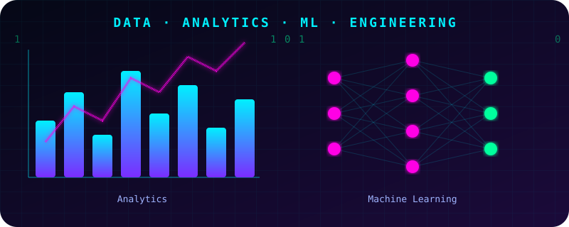
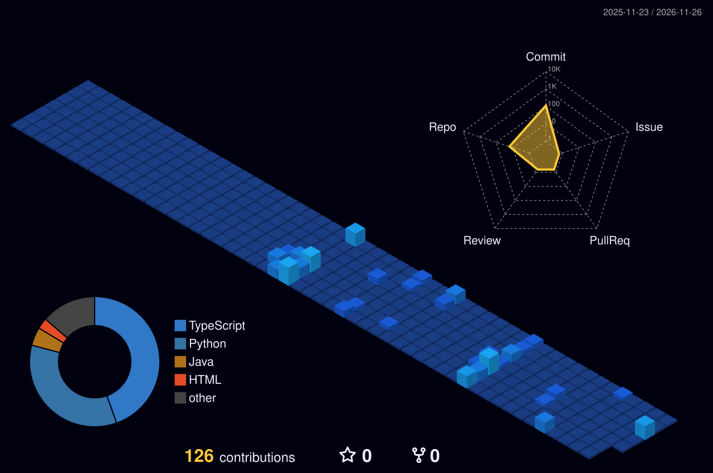

  

  

  

---

## 👾 About Me

- 🔭 Exploring **Data Science, Analytics, Data Engineering and Big Data**
- 🧠 Learning **Machine Learning, Deep Learning and Data Mining**
- 📊 I love turning messy data into clear stories
- 💬 Ask me about **Python, SQL, Pandas, Spark and visualization**
- ⚡ Goal: build smart, data-driven solutions

---

## 🛠️ Tech Stack

### 💻 Programming Languages

  
  
  
  
  
  
  
  

### 📊 Data Analysis and Science Libraries

  
  
  
  
  
  
  
  
  

### 🤖 Machine Learning and Deep Learning

  
  
  
  
  
  
  
  
  
  
  

### ⛏️ Data Mining and Web Scraping

  
  
  
  
  
  
  

### 📈 Data Visualization and BI

  
  
  
  
  
  
  
  
  

### 🏗️ Big Data and Data Engineering

  
  
  
  
  
  
  
  
  
  

### 🗄️ Databases

  
  
  
  
  
  
  
  

### ☁️ Cloud and Tools

  
  
  
  
  
  
  
  
  

---

## 📊 GitHub Stats
## 📁 Featured Projects

  
  

  
  

---

  
  

  

---
## 🐍 Contribution Snake

  <picture>
    <source media="(prefers-color-scheme: dark)" srcset="https://raw.githubusercontent.com/KmShoyab/KmShoyab/output/github-snake-dark.svg" />
    <source media="(prefers-color-scheme: light)" srcset="https://raw.githubusercontent.com/KmShoyab/KmShoyab/output/github-snake.svg" />
    
  </picture>

---

## 🌆 3D Contribution Graph

  

---

## 🤝 Let's Connect

  
  
  
  

  

