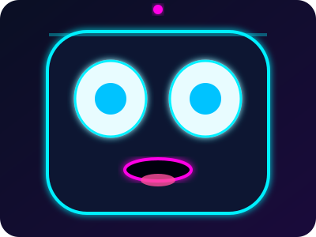

<!-- Animated header banner -->

  

<!-- Animated robot face -->

  

<!-- Typing text animation -->

  

---

## 👾 About Me

- 🔭 I'm currently working on **exciting projects**
- 🌱 I'm learning **new technologies every day**
- 💬 Ask me about **coding and tech**
- ⚡ Fun fact: **I love building cool things**

---

## 🛠️ Tech Stack

  
  
  
  
  

---

## 📊 GitHub Stats

  
  

  

---

<!-- Animated footer -->

  

